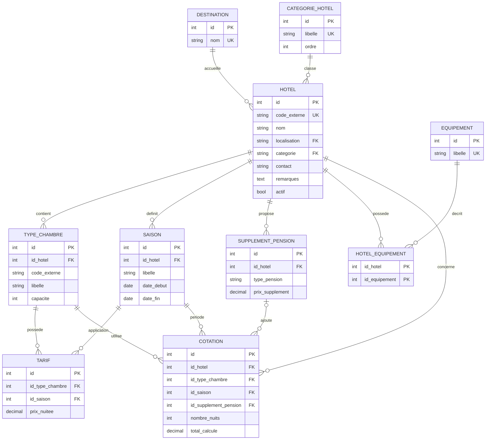
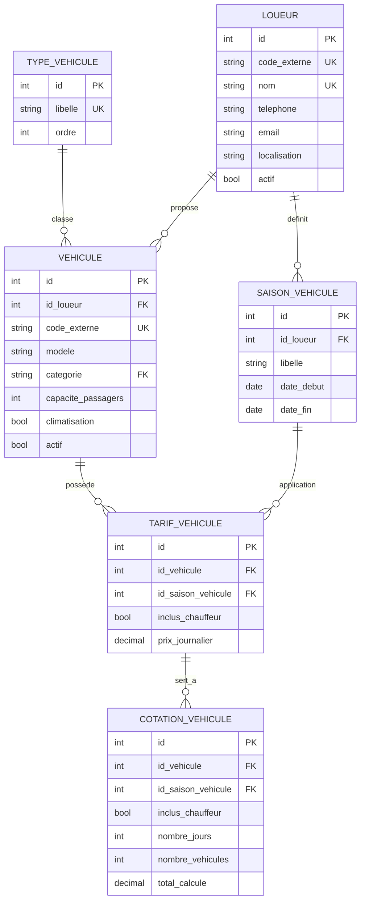

# Diagrammes entité-relation (MCD / MLD)

Les deux bases sont **séparées et indépendantes** : il n'existe aucun lien entre les deux diagrammes.
Les diagrammes s'affichent automatiquement sur GitHub. Le détail de chaque colonne est dans `DICTIONNAIRE_DONNEES.md`.

## Base Hôtels (`honey_hotels`)

## Base Véhicules (`honey_vehicules`)

PK = clé primaire, FK = clé étrangère, UK = valeur unique.
